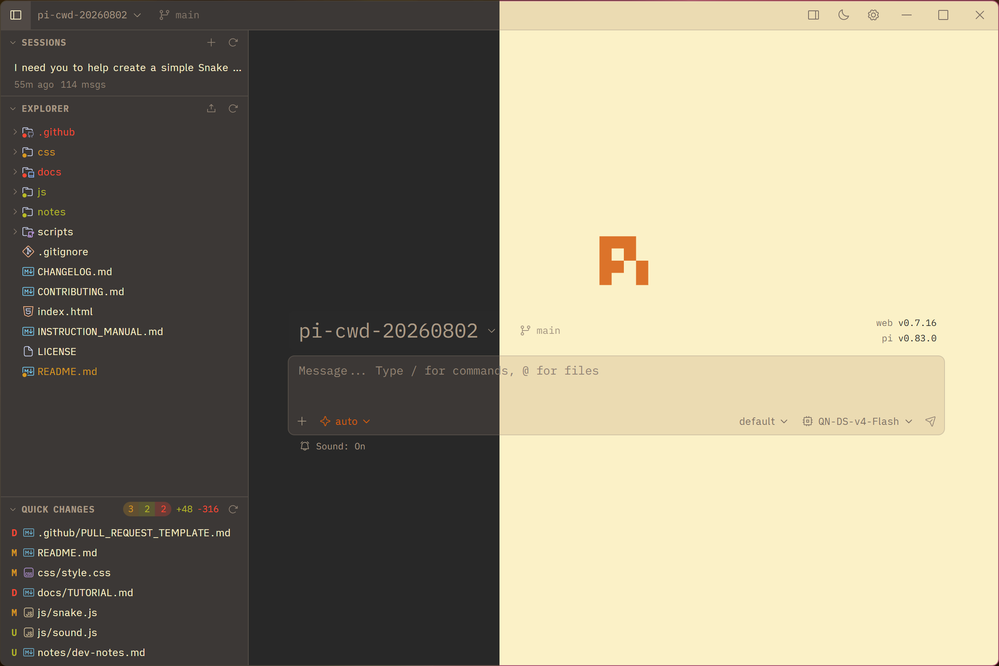
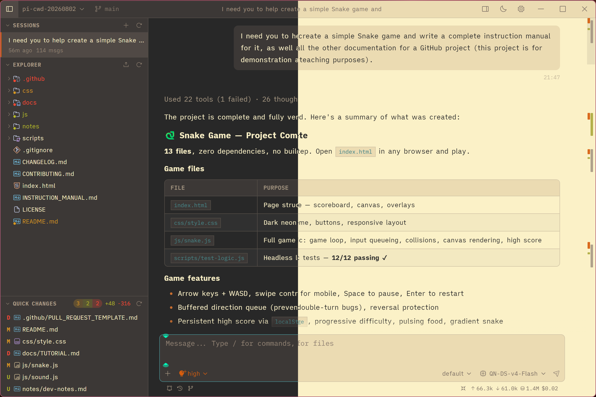
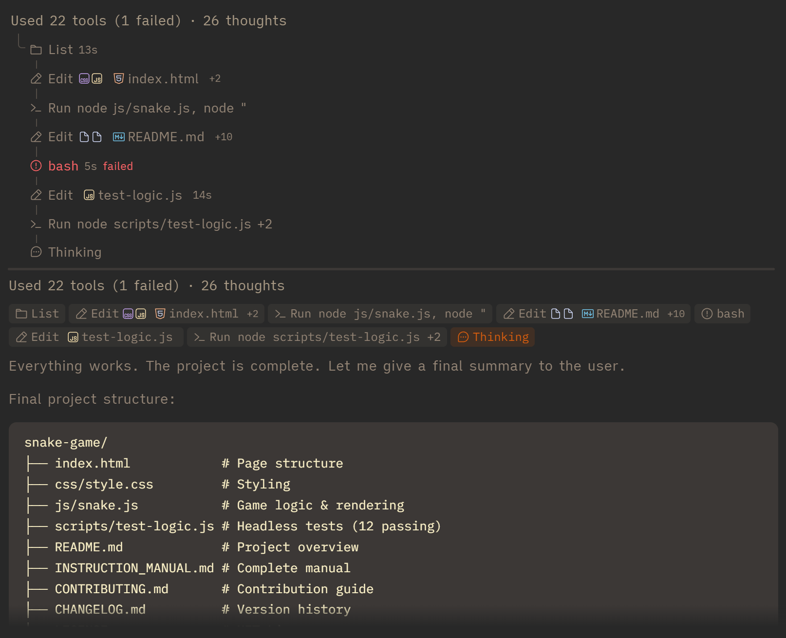
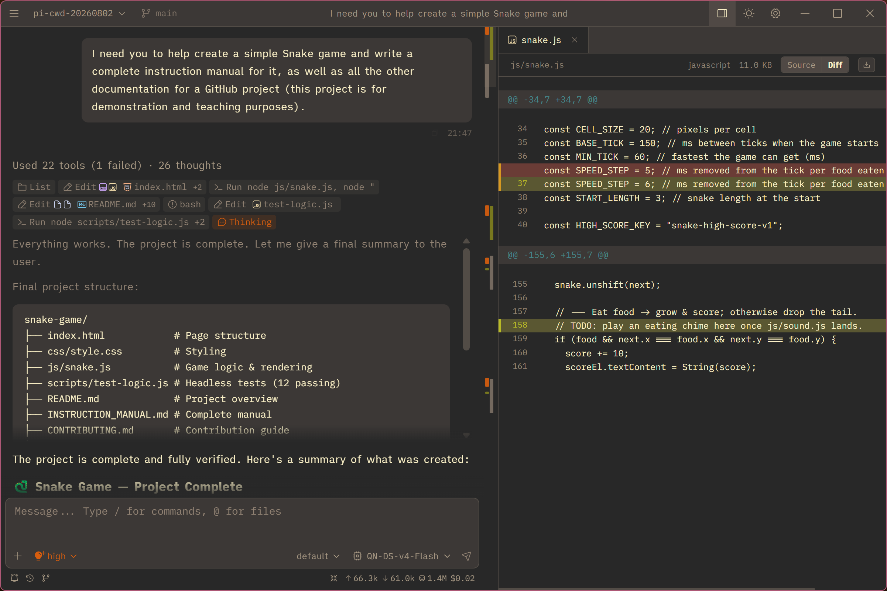

# 运维数字化Ai助手

[English](./README.md)

<p align="center">
  
</p>

<p align="center">
  面向 <a href="https://github.com/earendil-works/pi">pi 编程智能体</a> 的 Electron-first 桌面客户端。
</p>

<p align="center">
  <a href="https://github.com/happyzengfen/pi-alpha-desk/releases">Releases</a>
  ·
  <a href="https://github.com/happyzengfen/pi-alpha-desk/issues">Issues</a>
</p>

## 项目概览

运维数字化Ai助手（`@happyzengfen/pi-alpha-desk`）从上游 [pi-web](https://github.com/agegr/pi-web) `v0.7.16` 起步，目前已发展为独立的 Electron-first 桌面产品。它为本地 pi 会话提供可视化工作区，同时保持与 pi 的会话存储、模型、认证、Skills、插件和主题格式兼容。

本仓库不是上游镜像。产品优先保护桌面窗口、标题栏、侧栏、流程时间线、主题、字体和文件工作区体验；上游的 SDK 兼容、安全、数据完整性、认证、SSE 与可靠性修复会经过适配后选择性引入。

### 当前开发基线

| 项目 | 版本 |
| --- | --- |
| 应用 | `1.0.0` |
| Node.js | `>=22.19.0` |
| Next.js | `16.3.0` |
| React | `19.2.x` |
| Electron | `43.x` |
| Pi SDK registry fallback | `0.99.1` |

## 2026-09-23 更新重点

- 四个核心 Pi SDK 从 `0.85.1` 同步升级为 `0.87.1`，并更新锁文件与插件依赖覆盖。
- 适配新版 SDK 的提示词生命周期、系统消息与上下文编辑，保留桌面会话历史及分支 ID。
- 本地源码快照采用上游完整 workspace 构建顺序，支持按 commit 恢复，发布流程保留当前启用的快照。
- 重新生成 Apple Silicon 原生 arm64 的 DMG 与 `.app`，实际验证 Electron 窗口、聊天输入区、主要接口和会话 HTML 导出。

应用版本保持 `1.0.0`。详见[更新日志](./docs/CHANGELOG.md#pi-0871-升级与-macos-arm64-重新构建2026-09-23)和[构建与发布说明](./docs/release.md)。

## 2026-08-09 更新重点

- 修复首条消息 Fork 返回幽灵 session 的数据完整性问题，新会话会先创建合法 JSONL 文件。
- 文件访问改用 canonical realpath 边界，阻止授权根内的符号链接跳转到根外。
- Electron Renderer 启用 sandbox，并补齐导航、新窗口、webview 和全部 IPC 来源校验。
- `showItemInFolder` 调用系统 shell 前必须通过服务端文件 allow-list 授权。
- 文件 watch 增加快照去重；凭据与上传覆盖改为原子写入。
- 服务进程异常退出会显示日志、code/signal 并完整退出，不再隐藏为不可用托盘进程。
- bundled skills 尊重 `PI_CODING_AGENT_DIR`；macOS 编辑菜单和常用 Command 快捷键完成回归验证。
- Next.js、Mermaid、Undici 等依赖升级到修复版本，完整依赖审计为 `0 vulnerabilities`。
- 新增三平台 PR 质量矩阵、macOS arm64 打包验证和 Windows 动态端口 smoke。
- 建立可复现桌面性能基准；30 分钟固定负载完成 175,300 轮，未发现内存持续单调增长。

完整内容与验证证据见[本次更新记录](./docs/2026-08-09-183710.md)和[桌面助手优化报告](./docs/desktop-assistant-optimization.zh-CN.md)。

## 主要功能

- **本地会话工作区**：浏览、重命名、删除、Fork、会话内分支、HTML 导出和恢复 pi JSONL 会话。
- **实时对话与恢复**：按会话 SSE streaming、刷新/后台/在线状态恢复、running-state reconciliation、compaction、abort、steer/follow-up、Thinking 和工具结果展示。
- **过程时间线**：将思考、工具调用和结果组织为多步骤过程组，支持不同展示模式、折叠、独立滚动窗口和 minimap 定位。
- **桌面原生外壳**：无边框窗口、自定义标题栏、原生目录选择、系统托盘、单实例、动态本地端口和 macOS 编辑快捷键。
- **项目与 Git 工具**：文件树、模糊搜索、Git status/diff、快速变更入口和 Git worktree 管理。
- **丰富文件预览**：源码、diff、图片、音频、PDF、DOCX，以及包含受控本地资源的 Markdown。
- **模型与认证管理**：配置和测试模型、管理 API Key，以及完成支持的 OAuth/device-code 登录。
- **Skills 与插件**：查看已加载资源、搜索/安装 Skills、管理 package plugins，并通过 project trust 保护项目资源。
- **增强 Markdown**：GitHub Flavored Markdown、语法高亮、Mermaid、KaTeX 和经过清理的内嵌 HTML。
- **主题与本地化**：pi / PI-TUI JSON 主题、深色/浅色/系统模式、English 和简体中文。

## 截图

主界面（左深色、右浅色）：



对话界面（左深色、右浅色）：



按工具调用分组的多步骤展示：



文件差异预览：



## 安装与运行

### Windows x64 桌面版

从 [GitHub Releases](https://github.com/happyzengfen/pi-alpha-desk/releases) 下载：

- `运维数字化Ai助手 Setup <版本>.exe`：NSIS 安装版
- `运维数字化Ai助手-<版本>-portable.exe`：免安装便携版

未签名开发包可能触发 Windows SmartScreen。请先核对下载来源，再选择“更多信息 → 仍要运行”；对外发行应配置正式代码签名证书。

### macOS arm64 桌面版

仓库提供 macOS arm64 构建、包结构校验和实际启动验证。2026-09-23 已在 Apple Silicon、macOS 26.5.2 上验证当前 `1.0.0` / Pi `0.87.1` 包。此类本地构建未配置 Developer ID 签名和 Apple notarization。

在没有运行开发服务器的独立 checkout 中构建：

```bash
npm ci
npm run icons
npm run build
CSC_IDENTITY_AUTO_DISCOVERY=false npx electron-builder --mac dmg --arm64 --publish never
node scripts/verify-macos-package.mjs --dir release/mac-arm64 --arch arm64
hdiutil verify release/*.dmg
```

默认生成：

```text
release/运维数字化Ai助手-<版本>-arm64.dmg
release/mac-arm64/运维数字化Ai助手.app
```

先从应用菜单或托盘完全退出旧版，再打开 DMG，将应用拖入“应用程序”进行安装或替换。完整的独立构建目录、校验与安装步骤见[构建与发布说明](./docs/release.md)。安装包保存在本地，不随源码提交自动上传到 GitHub Releases。

### 从源码运行

要求：

- Node.js `>=22.19.0`
- npm
- 已有 pi 配置，或在应用中配置 provider 凭据

```bash
npm install
npm run dev
```

浏览器打开 [http://localhost:30141](http://localhost:30141)。默认开发命令使用 Webpack；Turbopack 可通过 `npm run dev:turbo` 启动。

运行 Electron 开发外壳：

```bash
npm run electron:dev
```

## 桌面行为

- Electron 桌面服务默认只监听 `127.0.0.1`。
- 默认端口 `30141` 被占用时，打包应用会自动选择其他本地端口。
- 关闭窗口会隐藏到托盘；通过托盘菜单的 **Quit** 完整退出。
- 启动诊断写入 Electron 应用数据目录中的 `pi-web-server.log`。
- 自有 Next.js 服务异常退出时会显示日志路径、末尾输出、code/signal，然后完整退出。
- 五个通用 Pi 插件作为精确版本应用依赖随包交付：子代理、MCP、Web 访问、结构化提问和目标执行。版本及 npm integrity 记录在 `bundled-plugins/manifest.json`。
- 缺失的内置 starter skills 会复制到当前 pi agent 目录；已有用户版本不会被覆盖。`0.8.7` 内置 `guizang-ppt-skill`、`office-viewer`、`pdf` 和 `windows-word-docx`，来源、许可证、平台与内容哈希记录在 `bundled-skills/manifest.json`。
- macOS 使用原生编辑菜单与 Renderer fallback，支持常用 Command 编辑快捷键。

## 数据、会话与项目访问

- **Agent 数据目录**：默认为 `~/.pi/agent/`；可用 `PI_CODING_AGENT_DIR` 指向其他目录。
- **会话文件**：默认位于 `~/.pi/agent/sessions/<编码后的 cwd>/<时间戳>_<uuid>.jsonl`。
- **模型配置**：Models 面板读写当前 pi agent 目录中的 `models.json`。
- **Fork 与分支**：Fork 创建新的 `.jsonl` 会话文件；“Edit from here” 在同一文件中建立另一条分支。
- **文件访问**：浏览和预览仅限 session cwd、解析后的 project root、生成的 `~/pi-cwd-*` 目录和显式允许根；canonical realpath 校验会阻止符号链接越界。
- **项目 trust**：项目扩展、packages、prompts 和 `.agents/skills` 在 SDK 加载或执行前必须获得信任。
- **Git worktree**：主 checkout 与 linked worktree 的会话按 project root 分组。详见 [pi-web Worktree](./docs/worktrees.zh-CN.md)。

## 主题

运维数字化Ai助手读取 pi 兼容主题：

```text
~/.pi/agent/themes/       # 全局主题
<project>/.pi/themes/     # 项目主题
```

完整字段与颜色定义参见 [pi 官方主题文档](https://pi.dev/docs/latest/themes)。

主题按基础名称组成集合，建议使用 `-dark.json` 和 `-light.json` 配对：

```text
gruvbox-dark.json
gruvbox-light.json
```

也支持单个 `<主题名>.json`。如果请求的深浅色变体不存在，应用会回退到单文件或另一侧变体。示例主题位于 [`docs/themes/`](./docs/themes/)：

- `gruvbox-dark.json` / `gruvbox-light.json`
- `solarized-dark.json` / `solarized-light.json`

## Web 与局域网访问

Web 服务默认监听 `127.0.0.1`，不要直接暴露到不可信网络。

有明确局域网需求时：

```bash
PI_WEB_PASSWORD='replace-with-a-strong-password' npm run dev:lan
```

Basic Auth 用户名固定为 `pi`，密码为 `PI_WEB_PASSWORD`。HTTP Basic Auth 不会加密凭据，必须配合 HTTPS 终止或可信 VPN。Host、Origin 与浏览器来源检查仍然生效；额外 hostname 需要通过 `PI_WEB_ALLOWED_HOSTS` 显式允许。

常用运行时变量：

| 变量 | 用途 |
| --- | --- |
| `PORT` | 服务端口，默认 `30141` |
| `PI_WEB_HOSTNAME` | 监听并允许的 hostname，CLI 默认 `127.0.0.1` |
| `PI_WEB_ALLOWED_HOSTS` | 额外允许的 hostname，逗号分隔 |
| `PI_WEB_PASSWORD` | 启用 Web/LAN Basic Auth |
| `PI_WEB_NO_OPEN` | 阻止 npm CLI 自动打开浏览器 |
| `PI_CODING_AGENT_DIR` | 覆盖 pi agent 数据目录 |
| `SKILLS_API_URL` | 覆盖 Skills 搜索 API |

npm CLI 还支持 `--port` / `-p`、`--hostname` / `-H` 和 `--no-open`。

## 开发

### 常用命令

| 命令 | 用途 |
| --- | --- |
| `npm run dev` | 在 `127.0.0.1:30141` 启动 Webpack 开发服务 |
| `npm run dev:turbo` | 使用 Turbopack 启动开发服务 |
| `npm run electron:dev` | Electron 开发模式 |
| `npm test` | 运行明确选择的跨平台源码 `*.test.mjs` 测试 |
| `node_modules/.bin/tsc --noEmit` | TypeScript 类型检查 |
| `npm run lint` | ESLint 检查 |
| `npm run benchmark:desktop` | 固定桌面性能夹具与隔离 Electron 启动基准 |
| `npm run build` | Next.js Webpack 生产构建 |
| `npm run electron:build` | 为当前平台构建 Electron 包 |

开发服务器运行期间不要执行 `next build` / `npm run build`，因为它会写入 `.next/` 并干扰正在运行的 dev server；只在发布或独立验证阶段构建。

### 本地 pi 快照

四个直接 Pi SDK 依赖固定为 registry `0.99.1`；`npm ci` 按锁文件安装当前支持的 SDK 和依赖，内置支持 GPT-6.1 Sol（`gpt-6.1-sol`）。本地源码快照脚本采用上游完整的 `build:offline` workspace 构建顺序，再打包六个运行时包：chord、pi-tui、pi-telemetry、pi-ai、pi-agent-core、pi-coding-agent。该流程已在 Pi `v0.87.1` 上验证，不修改 `package.json` 或 `package-lock.json`。

```bash
# 使用默认相邻目录 ../pi（需为兼容版本且工作树干净）
npm run pi:sync-local

# 或指定源码目录
npm run pi:sync-local -- --source /absolute/path/to/pi
```

可恢复最新缓存快照，也可指定 commit；验证默认跟随当前已安装快照的 commit：

```bash
npm run pi:sync-local -- --restore
npm run pi:sync-local -- --verify
# 多个快照并存时指定要恢复的 commit
npm run pi:sync-local -- --restore --snapshot <commit>
```

普通 `npm install`、`npm ci` 或 `npm dedupe` 会恢复 registry fallback。Windows 发布脚本仅在已安装 SDK 带有本地源码标记时恢复快照，并锁定同一个 commit；历史缓存不会自动覆盖 registry 版本。[旧快照记录](./docs/local-pi-update-2026-08-03.md)仅作为历史资料保留。

## CI 与发布验证

- **Quality**：Ubuntu 24.04、Windows 2025、macOS 15 的 PR/push 快速矩阵，执行安装、测试、TypeScript、Lint 和 diff check。
- **Windows x64**：构建并验证 unpacked、NSIS、portable，覆盖固定端口和占用 `30141` 后的动态端口启动。
- **Desktop packages**：手动构建 macOS arm64/x64 DMG 与 Linux arm64/x64 AppImage；执行包结构校验和 Renderer 启动验证。

### Windows x64 本地打包

应优先在 Windows x64 环境构建，确保 npm 解析正确的原生依赖：

```bash
npm ci
npm run electron:win:x64
```

该命令先创建并验证 `release/win-unpacked/`，再从同一目录生成 NSIS 与 portable。仅构建解包目录时：

```bash
npm run electron:win:x64:dir
```

完整流程见 [GitHub Actions：Windows x64 构建说明](./docs/github-build-windows.md)。

### 发布前检查

```bash
npm test
node_modules/.bin/tsc --noEmit
npm run lint
git diff --check
npm audit --registry=https://registry.npmjs.org
```

发布包必须在目标平台验证实际解包目录和启动路径，不能只用同一套纯函数测试声称跨平台通过。

## 项目结构

```text
app/                  Next.js App Router、全局样式与 API routes
components/           桌面 React UI、聊天、设置、侧栏与文件视图
hooks/                会话、主题、i18n、音频、拖放和布局 hooks
lib/                  SDK 集成、会话解析、安全、Git、文件和 Markdown
lib/i18n/             语言 registry、格式化与 en / zh-CN 词条
electron/             Electron 主进程、preload、托盘和服务生命周期
bin/                  npm CLI 入口与启动参数解析
scripts/              本地 Pi 同步、性能基准、发布与包验证
bundled-skills/       打包进桌面应用的 starter skills
docs/                 架构、优化、安全、性能、Worktree 与发布文档
tasks/                本轮优化计划与完成清单
public/               图标、字体相关资源和文件图标主题
```

关键入口：

- [`components/AppShell.tsx`](./components/AppShell.tsx)：主布局、URL 状态、侧栏、聊天和文件 tabs
- [`components/ChatWindow.tsx`](./components/ChatWindow.tsx)：消息、streaming、reconciliation 与会话交互
- [`components/ChatInput.tsx`](./components/ChatInput.tsx)：输入、模型、工具、Thinking 与 slash commands
- [`components/FileViewer.tsx`](./components/FileViewer.tsx)：源码、diff、图片、音频、PDF 与 DOCX 预览
- [`lib/rpc-manager.ts`](./lib/rpc-manager.ts)：`AgentSessionWrapper` 生命周期和全局 registry
- [`lib/session-reader.ts`](./lib/session-reader.ts)：JSONL 会话解析和分支上下文
- [`lib/file-access.ts`](./lib/file-access.ts)：canonical file-access allow-list 边界
- [`electron/main.js`](./electron/main.js)：桌面窗口、托盘、本地服务和原生集成

## 相关文档

- [构建、安装与发布说明](./docs/release.md)
- [本地开发与使用手册](./docs/local-development.zh-CN.md)
- [2026-08-09 更新记录](./docs/2026-08-09-183710.md)
- [桌面助手优化报告](./docs/desktop-assistant-optimization.zh-CN.md)
- [桌面性能基线](./docs/desktop-performance-baseline-2026-08-09.md)
- [安全扫描报告](./docs/security-scan-2026-08-09/report.md)
- [架构与核心流程](./docs/architecture-and-core-flows.zh-CN.md)
- [Worktree 使用说明](./docs/worktrees.zh-CN.md)

## 与上游 pi-web 的关系

本项目从上游 pi-web `v0.7.16` 起步，但现已主动分化为 Electron-first 桌面产品。上游仍是 SDK 兼容、安全、数据完整性、认证、SSE 和可靠性修复的重要来源；涉及 UI 的行为会手工适配到本地架构，而不是整体替换桌面组件。

本项目不保证与上游功能完全一致，也不保证逐版本同步。

## License

[MIT](./LICENSE)
