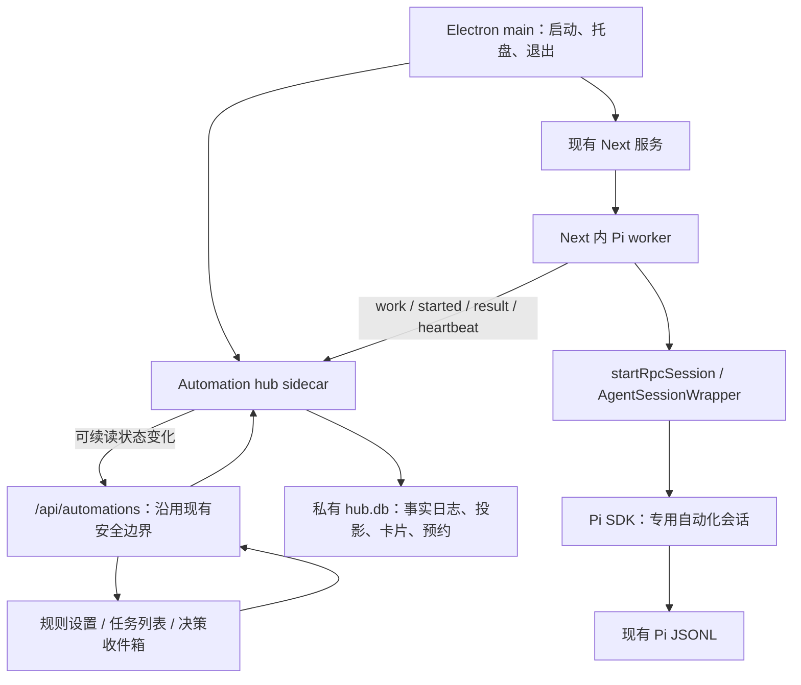

# Agent Autoloop 核心能力集成计划

> - 状态：首版 P0–P5 集成完成，隔离测试服务及应用登记已清理恢复；通知中心实际显示/点击定位按用户明确“跳过”免于本次手动验收，未经验证，不记为通过。其余证据及范围见 [执行记录](../tasks/agent-autoloop.md)；P6 仍为后续扩展。
> - 日期：2026-11-04
> - 适用项目：pi-alpha-desk / 数字化 AI 助手
> - 本地代码基线：`d588f0e8a01c3d13c6b6df502918b2165b4b6cad`
> - 参考项目：[KKKKhazix/agent-autoloop](https://github.com/KKKKhazix/agent-autoloop)，固定提交 `8f8e2eef3cfaa8f7a418818adc442450fe6bd884`

## 1. 建议与目标

建议在现有桌面应用中增加“自动化”能力：**复用 Agent Autoloop 的调度内核与通信协议，由本项目实现 Pi 执行适配、桌面生命周期和任务收件箱。**

用户配置一次任务后，事件或时间可以触发 Pi 执行；需要决定时，任务结束当前执行并留下持久卡片；用户回答后继续原任务。窗口隐藏到托盘、页面刷新、切换会话都不影响调度。完全退出应用后停止执行，下次启动恢复待处理状态。

核心交付是以下闭环：

```text
可信规则 + 事件/定时触发
  → 持久排队、合并与去重
  → Pi 在专用会话中执行一轮
  → 提交结果、问题卡片或延迟复查
  → 结束本轮、释放执行资源
  → 回答/到期后开启下一轮
```

本项目已内置 `pi-goal@0.50.0`。它负责会话内目标推进；Autoloop 负责跨轮次的事件、等待和调度。首版采用**回合回执模式**：自动化专用会话不加载 pi-goal 的续跑能力，由 Autoloop 决定何时开始下一轮；普通聊天继续使用现有 pi-goal。后续再验证 managed-run 联动，避免同一个任务同时被两个循环驱动。

## 2. 范围与默认假设

本计划默认个人本地使用，以 Electron 桌面体验为主。新增代码通过独立模块与少量接入点实现，保护现有标题栏、主题、字体、聊天流程时间线、文件预览和会话树。

### 2.1 首版交付

- 手动触发、一次性预约、带明确时区的周期规则。
- 任务列表、当前执行状态、历史轮次及原因时间线。
- 持久问题卡片、回答、关闭卡片，以及回答后的任务接续。
- `ask / notice / resolve / later / events` 回执契约；派生事件仅允许规则授权的类型。
- 去重、串行执行、有限重试、取消、结果不明处理、重启恢复。
- 全局同时执行一轮；仅允许用户明确启用的规则与项目。
- 在受支持的平台提供原生桌面通知；收件箱始终可用。

### 2.2 后续扩展

GitHub Issue、业务告警等外部来源，以及飞书、钉钉、Slack 等通知通道，等本地闭环稳定后按需接入。首版不建设工作流画布、多租户平台、插件市场或自动合并发布流水线，也不默认安装系统常驻服务。

### 2.3 平台约定

- 隐藏到托盘继续工作；菜单“退出”停止领取并有界结束自有进程。
- 电脑休眠、断电或完全退出期间不能执行；启动/唤醒后重新计算到期任务。
- 周期任务默认合并错过的触发点，只补一次检查，避免恢复时密集补跑；这一策略须通过适配测试落实，不能仅依赖内存定时器。
- 保留 Windows x64、Windows ia32、macOS 和 Linux 的现有应用路径。自动化功能按运行时探针启用，不能因某个平台不支持新运行时而让普通聊天无法启动。
- 初稿阶段只生成本计划；后续实现以用户另行授权为准，具体接入与验证记录单独维护，不默认替用户启用真实后台任务。

## 3. 现有基础与接入约束

以下依据当前代码核验，不能只按历史 AGENTS.md 或旧优化报告推断。

| 现有能力 | 代码证据 | 集成要求 |
| --- | --- | --- |
| Pi 会话统一创建、模型 scope、项目 trust、内置扩展加载 | [lib/rpc-manager.ts](../lib/rpc-manager.ts)，`startRpcSession()`，约 1129–1260 行 | Pi worker 复用此入口；不能在 sidecar 再打开同一 JSONL 写入 |
| prompt 异步执行，命令立即返回 | 同文件约 395–418 行 | 请求成功只是受理；必须等待当前轮次终态与 settled 状态 |
| wrapper 可脱离页面运行；10 分钟空闲后释放 | 同文件约 305–317、369–382 行 | 调度在服务端，预约在数据库，不能依赖 React 或 wrapper 的存活 |
| busy 状态包含 prompt、streaming、compaction、bash | 同文件 `isRunning()`，约 177 行 | 不能只看 `isStreaming` 判断能否领取下一轮 |
| 扩展对话框使用内存 Map/Promise | 同文件约 142–145、848–889 行；[useAgentSession.ts](../hooks/useAgentSession.ts) 约 382 行 | 可复用表单体验，但须另建持久卡片，不能直接视为耐久审批 |
| 已内置 pi-goal、结构化提问、子 Agent 等 | [bundled-plugins/manifest.json](../bundled-plugins/manifest.json)；[lib/bundled-pi-packages.ts](../lib/bundled-pi-packages.ts) | 自动化会话使用明确的扩展资源配置，排除相互竞争的续跑和无人响应的交互工具 |
| 非空工具预设会附加扩展工具 | [lib/rpc-manager.ts](../lib/rpc-manager.ts)，`withExtensionTools()`，约 124–133 行 | `toolNames: ["read"]` 不等于只读隔离；需要自动化专用的显式工具/扩展白名单 |
| 显式启动模型/思考等级会写入默认偏好 | [lib/startup-preferences.ts](../lib/startup-preferences.ts)、`rpc-manager.ts` 约 1223 行 | 自动化规则的模型选择仅作用于专用会话，新增受控启动选项避免改写用户默认配置 |
| 请求与项目边界已有实现 | [lib/request-security.ts](../lib/request-security.ts)、[lib/project-trust.ts](../lib/project-trust.ts)、[lib/file-access.ts](../lib/file-access.ts) | 新 API 与规则目录校验复用相同边界 |
| 开发版可复用已有服务；打包版选择端口并启动自有服务 | [electron/main.js](../electron/main.js) 约 516–545 行 | 明确 hub、worker 与服务所有权，避免双重初始化 |
| 关闭隐藏到托盘，Quit 终止自有服务 | 同文件约 405–409、617–626 行 | 区分隐藏、退出与恢复；仅结束本实例拥有的进程 |
| Node 最低 22.19.0，独立 Node 需匹配平台/架构 | [electron/node-runtime.js](../electron/node-runtime.js) 约 7–23、183–207 行 | 上游 Node 24 要求必须先做运行时与打包实验 |
| 标题栏、设置和 i18n 有现成结构 | [AppTitleBar.tsx](../components/AppTitleBar.tsx)、[SettingsModal.tsx](../components/SettingsModal.tsx)、[lib/i18n](../lib/i18n) | 局部增加自动化入口与收件箱，保留拖拽区域和双语覆盖 |

现有 `globalThis` registry 和启动 Promise 只解决同一个服务进程内的问题，不能承担跨进程租约、持久任务和崩溃恢复。当前 fork 会生成独立文件并关闭原 wrapper；自动化任务的会话绑定不能随用户 fork 静默迁移。

## 4. 采用哪些核心机制

### 4.1 保留上游契约

| 机制 | 本项目要保留的行为 |
| --- | --- |
| 标准事件与可信规则 | 来源与事件 id 去重；执行目录、模型、工具权限、Skill 由本机规则决定 |
| 事项与执行轮次分离 | 一件事可跨多轮执行；回答和预约触发新一轮，不让旧一轮一直占用 Agent |
| 事件合并与并发控制 | 待领取事件可合并；执行中来的新事件进入后续轮次；保留 group/lane 语义 |
| 事实日志与可重建投影 | 日志、投影、游标在同一事务提交，提交后才确认；不能只写 JSON 状态快照 |
| 领取与回执幂等 | claim、run、attempt、token 分工明确；同次结果重复提交不重复产生卡片/预约 |
| 持久问题与预约 | 卡片回答、later 到期均能带原会话上下文继续，服务重启不丢 |
| 有限重试与结果不明 | 明确失败按策略退避；失联且执行结果不明进入 `unknown`，先核实执行情况 |
| 事件链熔断 | 派生事件增加 hops；回答和 later 不清零；超过上游阈值时停止派发并留下通知 |
| 可解释历史 | 从事件、规则版本、领取、回执、回答追溯一轮为何发生 |

这里的幂等保证针对调度和回执，不代表发邮件、改远端资源等外部副作用天然只执行一次。此类动作还需要业务端幂等键或执行后核实。

参考：[上游执行与状态实现](https://github.com/KKKKhazix/agent-autoloop/blob/8f8e2eef3cfaa8f7a418818adc442450fe6bd884/kernel/decide.ts)、[事务存储](https://github.com/KKKKhazix/agent-autoloop/blob/8f8e2eef3cfaa8f7a418818adc442450fe6bd884/kernel/store.ts)。

### 4.2 不直接照搬的部分

上游 Agent 插件提供的是进程命令及输出解析接口，并非 Pi SDK 回调接口；其 worker 使用 POSIX shell 和进程组。上游系统服务安装也以 macOS/Linux 为主。因此，本项目自行实现跨平台 Pi worker 与 Electron 宿主，不运行上游安装脚本，不复制 shell worker、系统服务、完整 CLI 和交付插件。

上游 `package.json` 标记为 `private: true`、要求 Node `>=24`，运行层使用 `node:sqlite`，不能假定可通过 `npm install agent-autoloop` 直接集成。复用源代码时固定提交、按依赖闭包引入，并随发布保留其 MIT 许可证及来源说明。

参考：[Agent 接口](https://github.com/KKKKhazix/agent-autoloop/blob/8f8e2eef3cfaa8f7a418818adc442450fe6bd884/worker/agents.ts#L39)、[worker 实现](https://github.com/KKKKhazix/agent-autoloop/blob/8f8e2eef3cfaa8f7a418818adc442450fe6bd884/worker/worker.ts#L198)、[package.json](https://github.com/KKKKhazix/agent-autoloop/blob/8f8e2eef3cfaa8f7a418818adc442450fe6bd884/package.json)、[许可证](https://github.com/KKKKhazix/agent-autoloop/blob/8f8e2eef3cfaa8f7a418818adc442450fe6bd884/LICENSE)。

## 5. 技术路线与目标架构

### 5.1 方案选择

| 方案 | 收益 | 代价 | 结论 |
| --- | --- | --- | --- |
| 整套上游 CLI/daemon 接入 | 原有功能保留最多 | 双重配置、进程执行适配、Windows 与桌面生命周期不一致 | 适合个人试用，不作为产品集成主线 |
| 固定内核/协议 + 独立 hub + 原生 Pi worker | 保留调度语义与验证资产，同时复用当前 Pi 和桌面体验 | 要适配运行时、worker 与 UI | **推荐路线，先通过 P0 实验** |
| 完全重写本地队列 | 可自行选择兼容存储 | 需重新证明租约、回执、恢复、卡片和事件链的一致性 | 不作为首版默认方案 |

推荐采用独立 Node 24 hub 进程，隔离同步 SQLite、源代码运行方式与 Next 热更新；Pi worker 留在现有 Next 服务内，只有它可以调用本项目的会话创建入口。此处是设计选择，尚未经打包验证。



### 5.2 运行时与宿主边界

1. **hub 单独选择并验证 Node 24。** 不为这一能力直接提升整个应用的 Node 下限；原有聊天服务继续沿用现有选择逻辑。探针验证真实启动、SQLite 事务、JSON 查询、重放与发布资源定位，不能只检查版本字符串。
2. **编译为独立发布产物。** 按内核与协议依赖闭包生成 sidecar，显式携带 SQL/Schema 等资源。上游 runtime 会读取源文件计算投影指纹，编译后须设计稳定的格式指纹与升级重建测试，不能机械改后缀。
3. **宿主显式启动。** 仅 Electron 主进程拥有生产 hub；Next 在 Node 服务启动处初始化一个 worker，不在 Route Handler 或 React mount 中反复启动。开发模式支持显式启动，并防止热更新重复订阅。
4. **已有开发服务不隐式接管。** Electron 复用已有 Next 时，先核对自动化实例标识与握手；未配套启动则显示“自动化未连接”，普通聊天照常使用。不得误连另一数据目录的 hub。
5. **本机通信。** hub 只监听 loopback 的独立可用端口；UI 经现有 Next API 访问。owner/worker 凭据只在服务端通过受限文件或私有 IPC 取得，不进入页面、prompt、context、日志或工具子进程环境。
6. **平台能力显式降级。** Windows ia32 若没有可验证的 Node 24 运行路径，保留基础应用并明确禁用自动化；若产品要求 ia32 自动化同等支持，P0 必须先确定兼容运行时/存储方案，再进入后续开发，不能静默删掉该平台。

hub 采用应用专属数据目录，例如 Electron `userData/automation/`。不共享用户已有的 `~/.agent-autoloop`，不从 `ref-repos/` 打包，也不让页面选择任意数据库路径。

## 6. Pi 执行适配与状态设计

### 6.1 标识与数据归属

| 对象 | 归属与规则 |
| --- | --- |
| automation / rule | 本机可信配置；编辑后留存规则版本 |
| source + event.id | 来源事件幂等键；重复投递只产生一次路由效果 |
| subject / group / lane | 复用上游分组语义；MVP 全局容量额外限制为 1 |
| run / attempt | hub 的轮次和执行尝试；不能复用前端消息 id 代替 |
| claim / execution token | worker 领取与提交能力；保留上游重新签发、失效与重复提交规则 |
| piSessionId / sessionFile | worker 校验并绑定；JSONL 继续由 Pi 管理，事件不能指定任意 sessionFile |
| worker checkpoint / receipt outbox | 服务端私有执行记录与待交回执；不是第二套任务状态机 |
| card | 同 key 对仍 open 的卡片去重并返回旧卡片，不覆盖正文；卡片关闭后可再次创建 |
| timer | 同 rule/lane/key 更新或取消；与卡片去重语义分开处理 |
| task generation / resource owner | 本地新增的持久取消代次与资源占用记录；在 hub 事实/事务边界内维护 |

hub 是自动化状态的事实来源；Pi JSONL 是会话内容的事实来源。worker 检查点只记录执行关联、是否已开始、最后有效回执和提交确认，用于恢复提交与核实，不复制完整聊天数据库。

### 6.2 一轮执行

1. worker 以稳定 claim 领取任务，在发送 prompt 前持久记录 run、attempt、会话绑定和执行检查点。
2. 校验规则目录、项目 trust、模型可用性、任务取消代次、工具白名单和资源占用。自动化使用专用会话；编辑任务优先使用独立 worktree。规则模型只配置当前会话，不持久改写用户默认模型/思考等级。
3. 先订阅服务端事件，再调用 `startRpcSession()` 和 prompt；`started` 的时机与崩溃窗口由适配测试固定。
4. 不以 POST 返回、第一条 `agent_end` 或自然语言“已完成”直接结案。等待本轮 prompt 结束、SDK settled，确认没有 pending follow-up、retry、compaction 或 bash，并收集本轮最终 assistant 回复。
5. 复用上游回执解析与校验行为，解析最终回复中的协议块；Pi 的 thinking、工具结果和历史回复不参与解析。无协议块时遵循普通结果契约。
6. 业务完成后先持久保存规范化回执，再提交 hub；响应丢失时仅重交同一回执。确认落盘后清理 outbox 和本轮资源。
7. `done` 只表示本轮结束；任务是否还等待回答、预约或新事件，由持久对象决定。UI 分开显示“本轮完成”和“事项待决定/待复查”。

### 6.3 等待与恢复

- `ask`：先持久卡片，再结束本轮。用户回答是新的事件，携带原会话与问题上下文继续；等待期间无模型调用和轮询 prompt，轻量 hub/worker 可以继续常驻。
- `later`：预约存入 hub 到期表；wrapper 可以释放。到期重开会话；本项目新增事项级取消时同时抑制旧代次的预约。
- 首版自动化会话不加载 pi-goal 续跑与需要活跃窗口回答的扩展工具；如仍产生 UI 交互请求，受控结束并提示改用回执 `ask`，不能永久挂着工具 Promise。
- 恢复时优先补交已经落盘的结果；如果业务已经开始但最终结果不明，进入待核实状态，读取检查点和 JSONL 确认后再决定继续。
- 只有确认本轮尚未开始且原会话无法恢复时，才允许一次新会话回退；业务开始后的异常保留原会话，不新建会话重做全部步骤。
- 用户 fork、删除、手动修改自动化会话时，不自动重绑或重建；暂停受影响的任务并给出明确状态。人工接管前先停止自动化持有者。

### 6.4 失败、修复与取消

| 情况 | 处理 |
| --- | --- |
| 明确的临时执行失败 | 使用上游有限退避；不叠加第二套失败计数与重试队列 |
| worker 断联、业务结果未知 | 保留 `unknown` 语义，先核实；旧执行的有效结果仍按协议处理 |
| 回执 JSON 损坏 | 在原会话至多修复两次，只修复回执；修复轮关闭业务工具并防止 reload 重新启用 |
| 回执修复仍失败 | 保留原业务结论，通知回执未生效；不因此重新执行已完成业务 |
| 登录、身份验证等必须由用户恢复 | 持久问题卡片等待，不持续自动重试同一个阻塞 |
| 用户取消 | 原子持久化事项取消代次，抑制旧预约/待续跑意图，再中止本轮 prompt/bash/compaction，并等待有界清理 |
| 取消后迟到结果 | 除 run/attempt/token 外核对持久代次；旧代次只能留下执行记录，不能新建卡片、预约或派生工作 |

取消无法撤销已经完成的外部操作。恢复界面应展示已完成步骤与待核实步骤。执行超时须真正停止或隔离旧执行，不能只把 UI 状态改成失败就立即开下一轮。

**事项级取消属于本地新增契约。** 上游取消已领取 run 只是请求 worker 停止；在收到 cancelled 结果前，有效的 done 回执仍可能生效。因此，需要在 hub 的事实/事务边界内增加事项标识与代次校验，将取消、结果生效、预约触发和卡片回答排序：结果先提交的已生效动作保留记录，取消先提交则旧结果不得再产生调度效果。旧卡片回答、旧预约和已排队续跑均受同一代次约束，手动重新启用使用新代次。若需局部修改 kernel，作为独立补丁及一致性测试维护，不能只在 worker 内存中拦截。

**结果不明还必须保留本地资源占用。** 上游 unknown 不计入 claimed 并发，容量 1 并不能证明旧执行已停止。worker 对 Pi 会话及可写 worktree 的规范化路径建立持久排他占用；恢复后先核实旧 Pi/工具执行是否终止，无法核实时阻塞该资源。人工 prompt、fork、分支切换等写会话操作须先释放自动化持有者或明确接管，同目录的人工编辑会话也需检测冲突。不能仅因租约到期就允许第二个写入者。

参考：[Job 数据结构](https://github.com/KKKKhazix/agent-autoloop/blob/8f8e2eef3cfaa8f7a418818adc442450fe6bd884/protocol/job.ts)、[回执解析](https://github.com/KKKKhazix/agent-autoloop/blob/8f8e2eef3cfaa8f7a418818adc442450fe6bd884/worker/contract.ts#L90)、[worker 的恢复与 outbox](https://github.com/KKKKhazix/agent-autoloop/blob/8f8e2eef3cfaa8f7a418818adc442450fe6bd884/worker/worker.ts#L255)。

## 7. 权限、资源与桌面交互

### 7.1 执行边界

规则创建时明确目录、模型、允许工具/扩展、超时、可发事件类型与触发方式。默认关闭新规则，用户启用后才执行。首个试点只使用已验证的低影响工具；编辑任务在目录边界验证通过后启用。

- 外部正文作为资料文件输入，不能拼成系统指令；拒收能选择 cwd、agent、command、access 等执行属性的事件字段。
- `read/edit/full` 必须由本项目实际映射到工具执行策略。仅隐藏工具按钮、设置普通 preset 或在 prompt 写“请先问我”，都不是强制权限边界。
- 对无法约束的 shell、网络写入和扩展副作用工具，首版不自动授予。需要人工决定的动作先以卡片结束一轮；批准时重新核对动作、对象与当前状态，不把一次回答当作长期授权。
- 现有文件浏览 allow-list 不等于 Pi 工具沙箱；项目扩展属于可信本地代码。若需要操作系统级隔离，另设独立账号/容器方案，不在 UI 中作出未经验证的保证。
- 增加全局执行容量 1、单轮超时、每日启动轮数上限和重复无进展停机条件。hops 只能限制派生链，不能代替对持续外部触发的预算控制。
- 用量按本次执行上报，缺失保留“未知”；首版不承诺精确美元硬限额。显示模型已报告的 token/cost 与统计缺口。

参考：[上游事件输入校验](https://github.com/KKKKhazix/agent-autoloop/blob/8f8e2eef3cfaa8f7a418818adc442450fe6bd884/protocol/validate.ts#L39)、[上游安全边界](https://github.com/KKKKhazix/agent-autoloop/blob/8f8e2eef3cfaa8f7a418818adc442450fe6bd884/SECURITY.md)。

### 7.2 最小 UI

| 入口 | 功能 |
| --- | --- |
| 设置中的“自动化” | 创建/编辑/启停规则、时区、目录、执行范围与下一次运行时间 |
| 自动化任务面板 | 按事项查看排队、执行、待决定、待复查、失败和待核实；手动运行/暂停/取消 |
| 决策收件箱 | 展示问题、选项、原任务、已完成内容；选择或文字回答，刷新后状态保留 |
| 任务详情 | 展示事件、规则版本、执行轮次、会话入口、回执、回答与恢复记录 |
| 标题栏入口 / 原生通知 | 显示待决定数量；点击定位任务；控件保持 `app-no-drag` |

收件箱以数据库为准，现有聊天的 extension dialog 保持原语义。状态事件使用日志序号续读并提供初始快照/断线补偿，不能仅依赖某一次 SSE 推送。回答与关闭操作必须幂等；并发回答显示最终生效结果。

通知只在需要决定、完成、失败、恢复或结果不明等有意义的变化时发送。重复投递、规则轮询和应用重启不重复弹同一卡片。原生通知属于新增 Electron 能力：IPC 只接收经过校验的卡片/任务标识，不接受任意命令或导航地址；系统通知不可用时仍能在收件箱处理。

所有文案走 `useI18n()`，同步英文与中文目录；沿用现有主题变量、Phosphor 图标与标题栏交互习惯。

## 8. 建议文件边界

以下是实施时的候选文件，不是本轮已创建的模块。按实际依赖合并文件，避免为了分层制造空壳。

| 位置 | 职责 |
| --- | --- |
| `automation-hub/upstream/` | 经许可复用的固定内核/协议及必要资源，附提交与本地补丁记录 |
| `automation-hub/host/` | 应用专属入口、配置、数据库路径、时钟、HTTP 与退出适配 |
| `lib/automation/runtime.ts` | Next 服务内单个 worker 的启动、连接、停止与健康状态 |
| `lib/automation/pi-worker.ts` | work/started/result、心跳、会话及目录占用、终态判定、恢复与取消 |
| `lib/automation/checkpoint.ts` | 原子检查点、待交回执与敏感凭据保护；不另建调度真相源 |
| `lib/automation/policy.ts` | 可信规则到目录、扩展、工具与执行限制的映射 |
| `app/api/automations/**` | 状态、规则、手动事件、卡片回答、取消与状态流的 UI API |
| `components/AutomationPanel.tsx`、`AutomationInbox.tsx` | 独立任务与收件箱界面，按需要再拆分 |
| `electron/automation-host.js` | sidecar 运行时探针、启动所有权、握手、退出和通知桥接 |
| 现有文件的少量接入 | `rpc-manager.ts`、服务初始化入口、`electron/main.js`、`preload.js`、设置/标题栏和 i18n |
| 发布脚本与来源说明 | sidecar 构建、资源与平台 smoke、第三方许可证和更新记录 |

新增 API 不向 Renderer 返回 hub 密钥或 execution token。规则写入应校验后原子替换；无效规则保留最后有效版本并在 UI 显示错误，不能清空已有调度配置。

## 9. 分阶段实施计划

各阶段交付可独立评审的垂直路径，使用 `codex/` 前缀分支与聚焦提交。开发中不运行 `next build`；生产打包验证在单独发布环境执行。


### P0：验证技术路线，固定契约（P0，约 2–3 人日）

**任务**：在工作区之外建立隔离实验；固定上游提交与内核依赖闭包。验证 Node 24 sidecar、SQLite、编译资源、格式指纹、Windows 启停及包装路径。用当前 Pi SDK 验证无页面执行、settled 判定、检查点恢复、自动化会话排除 pi-goal/交互工具的方式。

**验收与验证**：

- Windows x64、macOS arm64 跑通真实运行时探针；Windows ia32 给出可复现结果与支持结论，Linux 建立 smoke 项。
- 一个无副作用 Pi 任务在没有 ChatWindow 的条件下完成，HTTP 受理与执行完成可区分。
- 确认 tools/extensions 策略在启动与资源 reload 后都有效；不会激活第二套续跑。
- 强制在“执行已开始但尚未提交结果”窗口退出，恢复时进入待核实，而非盲目新跑；核验跨 worker 重启的资源占用及遗留工具执行。

**检查点**：记录主路线是否成立，以及哪些平台可启用自动化。若不成立，先调整宿主/运行时方案与估算，后续阶段不以临时队列替代一致性设计。

### P1：手动事件 → Pi → 持久结果（P0，约 3–4 人日）

**任务**：接入受控 hub、服务端 Pi worker、规则校验、事件入口、单轮终态、检查点/outbox 和最小任务查询。首条规则只手动触发，不调用外部写入工具。

**验收与验证**：

- 同一事件提交两次只派发一次；一轮显示触发事件、规则版本、Pi 会话与结果。
- 相同 claim 的重试与 token 更新符合上游契约；相同回执重交不重复产生效果，不同回执按协议冲突。
- 阻断结果提交响应后重连，仅重交 outbox，不重复执行 Pi prompt。
- 普通聊天、模型 scope、项目 trust、无工具模式、会话 fork 和 SSE 回归通过；自动化模型设置不改变用户默认偏好。

**回滚**：关闭自动化启动开关，保留私有数据库与检查点；普通会话链路继续工作。

### P2：持久问题 → 释放执行 → 回答接续（P0，约 2–3 人日）

**任务**：支持回执解析、`ask/notice/resolve`、收件箱基础 UI、回答去重与原会话接续；处理损坏回执与至多两次工具关闭的修复。

**验收与验证**：

- Agent 提问后当前轮次已结束；等待期间模型调用数不增长，空闲 wrapper 可释放。
- 刷新页面、切换会话、重启应用后卡片仍存在；回答一次只启动一轮接续。
- 两个窗口同时回答、重复点击、关闭已解决卡片均得到一致最终状态。
- 原会话无法恢复时按“是否已经开始业务”分流；回执修复失败不会重做业务。

**回滚**：停止新任务并保留未解决卡片与查询路径；不删除 Pi JSONL。

### P3：预约/周期 → 复查 → 暂停取消（P1，约 3–4 人日）

**任务**：接入 cron、一次性预约、`later/events`、hops 与 emits 校验、有限失败重试、容量/超时/启动轮数限制，以及持久事项取消代次的原子实现和完整清理路径。涉及的本地 kernel 补丁独立记录。

**验收与验证**：

- 用可注入时钟验证时区、到期、夏令时边界及休眠/退出错过触发后的合并补跑策略。
- 同一 timer key 更新/取消生效，重启不重复触发；穷举取消与 result、预约到期、旧卡片回答的先后顺序，取消后旧代次不再唤醒任务。
- `unknown` 不被当作普通 failed 重派；旧执行未核实终止前，后续工作无法占用同一会话/可写目录，即使 hub 已能派发新 run。
- 递归事件超过允许深度停止派发；未授权 emits 被拒绝，持续外部触发也受本地限额控制。

**回滚**：停用自动触发入口并停止领取，保存预约状态；重新启用前执行到期核对。

### P4：桌面入口、规则管理与通知（P1，约 2–3 人日）

**任务**：补齐设置、任务详情、规则启停、标题栏计数、原生通知与点击定位；集成 Electron 服务所有权和有界退出。

**验收与验证**：

- 隐藏到托盘继续执行；完全 Quit 停止领取并保存状态；重开不重复派活。
- 开发复用服务、打包自有服务、端口占用、第二实例启动各有唯一调度所有者。
- 通知去重、无系统通知时可处理卡片；标题栏拖拽与窗口控制、主题、双语及键盘操作正常。
- 自动化不可用只影响该功能，普通聊天仍可启动；状态页可解释未启用原因。

**回滚**：移除入口并关闭宿主启动；保留只读历史与恢复路径。

### P5：故障矩阵、备份升级与发布（P0，约 3–5 人日）

**任务**：在隔离数据目录跑真实 hub/Pi 故障实验；保留适用的上游内核测试并补充本地集成测试。验证数据库与密钥备份、格式升级、原版本恢复限制、各架构打包与日常性能。

**验收与验证**：

- 覆盖领取前、Pi 开始后、回执持久化后、hub 提交后但响应丢失、卡片回答后、退出过程中崩溃。
- 已确认事件/回答不丢失，outbox 可重交，旧 attempt/代次/迟到结果不污染新状态，未知执行及遗留子进程需要核实；跨 worker 重启不丢失排他占用。
- 备份使用一致性 SQLite 备份或停机复制，包含 `master.key` 与 worker 检查点；不能直接只拷贝运行中的主 db 忽略 WAL。
- 升级前备份数据与配置，重建投影结果一致；不假定新数据库可直接交给旧二进制读取。
- Windows x64、Windows ia32、macOS arm64 形成真实启动记录；Linux 的交付声明与实际 smoke 覆盖相符。
- 自动化关闭/空闲/运行时分别测启动、内存和流式聊天响应；与 P0 基线比较，无明显聊天退化。

**发布与回滚**：先小范围显式启用，普通用户默认关闭；代码回滚与数据恢复分开记录。不确定格式兼容时停用自动化并保留数据，而非强行用旧版本写库。

### P6：按需扩展来源与 pi-goal 联动（后续，不计入首版）

每次只接一种真实来源/通道，补齐验签、稳定事件 id、凭据和投递去重。先采用主动拉取等本机可运行方式，不为接 Webhook 默认开放桌面服务到公网。

pi-goal managed-run 仅通过公开的 sibling extension 事件总线接入。其 RPC 默认关闭，恢复的 Goal 不会自动认领旧 managed run；`runId` 持久化本身不足以恢复终态订阅。只有会话恢复、取消、预算、等待与归属协议实验通过，才允许替代首版回合模式；不调用包的私有内部 runtime。

## 10. 验证门禁与完成标准

实现期间按改动范围运行聚焦测试；阶段完成时运行现有基础门禁：

```bash
npm test
./node_modules/.bin/tsc --noEmit
npm run lint
git diff --check
```

sidecar 的专用测试须显式指定 Node 24 与源码范围，不混入普通应用的 Node 22 测试发现；复用的上游测试需要验证本地适配后的实现，不能把“上游测试通过”当作本项目集成已通过。打包及真实进程故障检查在独立发布工作区执行。

首版完成必须同时满足：

1. 手动事件与周期任务都可驱动专用 Pi 会话，并能追溯触发原因。
2. 持久等待不持续调用模型；回答与 later 能接续任务，重启后仍成立。
3. 重复事件、重复回执、重复回答与迟到结果有明确且经过测试的行为。
4. `unknown`、恢复失败与损坏回执不会导致盲目重复业务。
5. 取消、托盘、完全退出、开发复用服务和打包启动都符合宿主所有权约定。
6. 现有桌面资产、聊天、模型、trust、文件边界和 i18n 回归通过；平台差异明确可见。
7. 第三方来源、版本、许可证、本地补丁、备份升级和停用路径可审查。

粗略投入为 **15–22 人日**，基于一名熟悉项目的开发者、可用的平台验证环境和 P0 主路线成立。该数值包含首版本地闭环与发布验证，不包含外部通道、系统常驻服务、完整 Goal 联动和新增操作系统隔离。P0 结果可能改变范围与估算。

## 11. 原始首个开发任务（已完成）

原计划从 P0 开始：**验证独立 hub 与当前 Pi 的最小原生适配，再制作完整设置页面。** 此实验及首版 P0–P5 集成现已完成，验证结果和用户跳过的通知手动验收见[执行记录](../tasks/agent-autoloop.md)。

交付一份实验记录，包含固定源码版本、实际 Node/平台探针、无页面 Pi 执行、结束与 settled 判定、工具/扩展隔离、检查点与未知执行恢复结果，以及 Windows ia32 的支持结论。通过后进入 P1，逐步交付可运行闭环。

## 12. 参考资料

- [Agent Autoloop 固定版本总览](https://github.com/KKKKhazix/agent-autoloop/tree/8f8e2eef3cfaa8f7a418818adc442450fe6bd884)：本计划的上游基线；后续更新单独评审。
- [协议说明](https://github.com/KKKKhazix/agent-autoloop/blob/8f8e2eef3cfaa8f7a418818adc442450fe6bd884/docs/protocol.md)：接口、卡片、重试、日志与一致性契约。
- [运行层](https://github.com/KKKKhazix/agent-autoloop/blob/8f8e2eef3cfaa8f7a418818adc442450fe6bd884/host/runtime.ts)：SQLite、目录、密钥、配置及格式指纹；导入即初始化，须适配宿主。
- [本地架构文档](architecture-and-core-flows.zh-CN.md)、[本地开发说明](local-development.zh-CN.md)：现有项目背景；版本事实以当前代码为准。
- 本地已安装 `@narumitw/pi-goal@0.50.0` 的 `README.md` 中 Managed run RPC、Interruption 与 Waiting 章节：P0/P6 的能力与恢复限制依据；这是安装依赖核验结果，不承诺未来版本接口不变。
